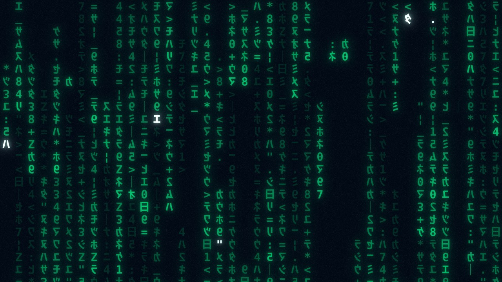

# Code Rain 1999

**The 1999 digital rain as a live wallpaper for [Lively Wallpaper](https://github.com/rocksdanister/lively) (Windows).**

Rebuilt cell by cell and frame by frame: 53 mirrored glyphs that never fall – they write. New glyphs light up beneath the old ones, gaps refill, erasers wipe the trail clean, and twin strings run in neighbouring columns, just like in the film's opening.

[**▶ Download Code-Rain-1999-Lively.zip**](https://github.com/E11i0t09/Code-Rain-1999/releases/latest/download/Code-Rain-1999-Lively.zip)

## Install

1. Download `Code-Rain-1999-Lively.zip` from [Releases](../../releases/latest).
2. Drag the zip into the Lively window and assign it to your screen(s). Each monitor runs its own instance.
3. Adjust everything in Lively → *Customise*.

## Settings

Palette (authentic / movie / custom colour) · background · animation speed · columns · trail brightness and falloff · erasers · glyph lifetime · highlighted leaders · glyph change interval · twin strings · random glyphs in gaps · cursor stammer · bloom · brightness · noise · frame-rate limit.

## Credits & legal

- Character inventory: Carl Newton, frame-by-frame analysis of the 1999 opening – [carlnewton.github.io/digital-rain-analysis](https://carlnewton.github.io/digital-rain-analysis)
- Cell model, timing and "Authentic" palette: [matrix.watch](https://matrix.watch), Authentic style description
- Glyphs rendered from Noto Sans JP Bold (SIL OFL 1.1) and DejaVu Sans Mono Bold (Bitstream Vera license)
- Concept, film observations, colour measurements and defaults: E11iot

Non-commercial **fan tribute**. Not affiliated with or endorsed by Warner Bros. or any other rights holder; names are used only to describe the inspiration. No film footage, logos or original assets are included – the effect is drawn live in code.

© 2026 E11iot – [CC BY-NC-ND 4.0](https://creativecommons.org/licenses/by-nc-nd/4.0/): use and share unchanged, with attribution, non-commercially.
